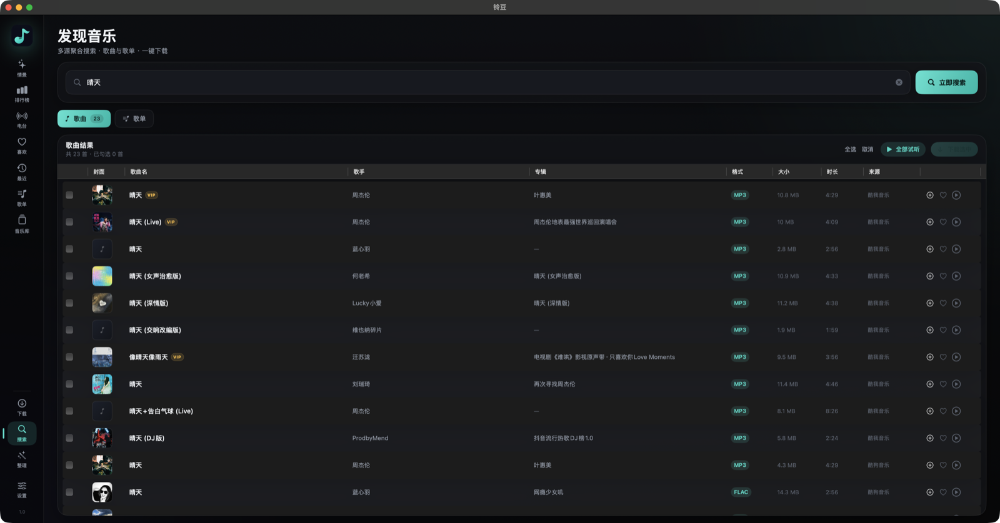
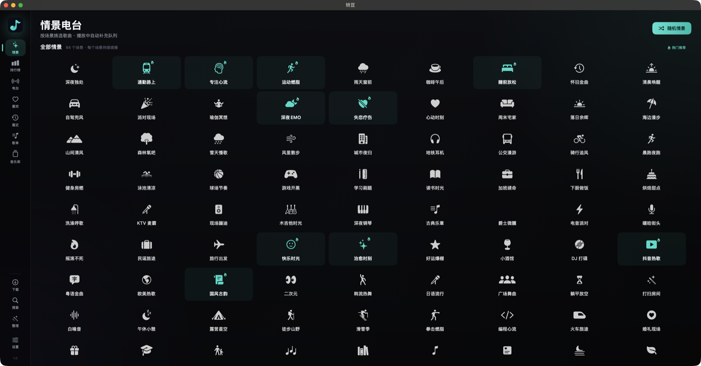
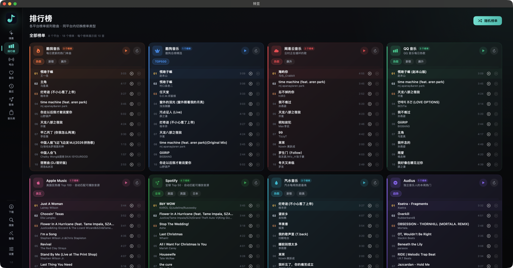
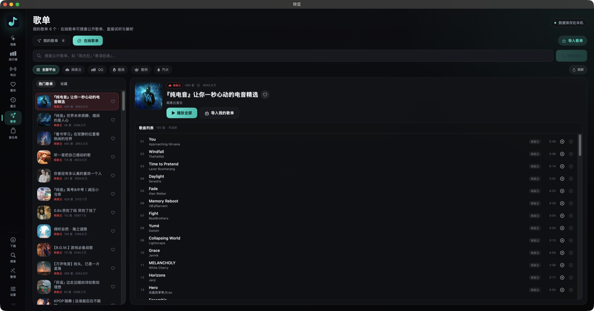
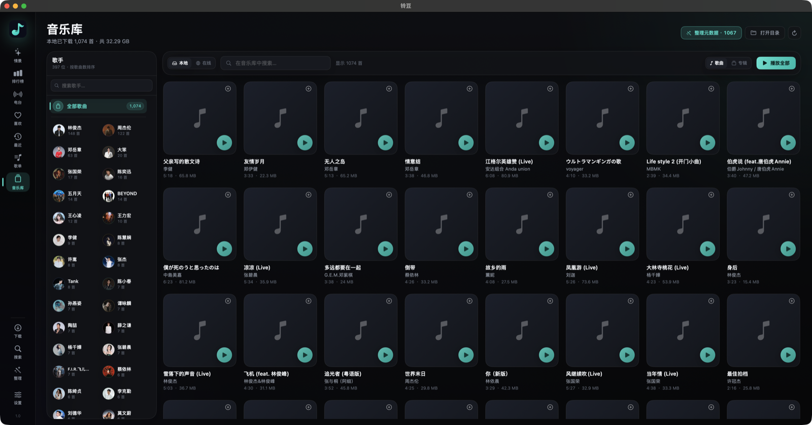

# 铃豆（macOS 原生版）

<p align="center">
  
</p>

铃豆是一款原生 macOS 音乐播放与下载工具：不用安装 Python，直接编译为独立应用。它把「搜索下载」「播放器 / 本地音乐库」「情景电台」与「喜欢 / 最近 / 歌单」整合在同一个深色沉浸式界面中，支持酷我、酷狗、网易云、汽水音乐与 Audius 多个音源。

<p align="center">
  
</p>

## 功能

### 搜索与下载

- 多平台并发搜索：酷我音乐、酷狗音乐、网易云音乐、汽水音乐可任选一个或多个，另支持 Audius
- 搜索结果表格：封面、歌名、歌手、专辑、格式、大小、时长与来源，支持点击表头排序
- 批量下载：勾选歌曲后点「下载选中」，或按「勾选 / 全选 / 未勾选」范围下载
- 歌单导入：粘贴酷我、酷狗、网易云、汽水（含短链）歌单链接直接导入；QQ 歌单会读取全部曲目并在已启用音源中逐首匹配
- 在线歌单：浏览与搜索各平台公开热门歌单，直接试听、解析或导入「我的歌单」，可收藏并在本机保留
- 后台下载：独立「下载」页并发执行，可调同时下载数（1–6），支持暂停、继续、重试与移除
- 低频下载：汽水音乐固定单路、每首间隔约 3 秒，其它音源约 0.5 秒，降低触发会员下载次数限制的风险
- 下载去重：按「歌名 + 歌手」判重，已存在本地或下载队列时自动跳过，同一首歌只保留一份文件
- 歌词与文件命名：下载音频时同步获取 `.lrc` 歌词；文件名规则为「歌曲名-歌手-专辑-平台ID」
- 保存目录可自定义，默认 `~/Music/已下载音乐`

### 播放与音乐库

- 在线试听：搜索结果行内直接播放；VIP 曲目与汽水音乐试听片段会标注「试听 / 完整」
- 播放队列：上一首 / 下一首、随机播放、列表循环 / 单曲循环；右侧队列面板可点选切换或移除
- 复合「添加」菜单：任意歌曲行都可「下一曲播放」「添加到队列末尾」，或加入指定歌单 / 新建歌单
- 沉浸式播放页：模糊封面背景、波形进度条、音量控制与逐行滚动歌词；底部常驻迷你播放器
- 本地音乐库：自动扫描保存目录中的 MP3 / FLAC / M4A / AAC / WAV / OGG / APE，读取内嵌封面与标签
- 歌曲 / 专辑视图与歌手筛选：左侧歌手卡片按歌曲数量排序，右侧展示该歌手的歌曲
- 在线搜索：音乐库内可在本地 / 在线之间切换，在线结果可直接试听、收藏、加入歌单或下载
- 整理元数据：扫描缺失标题 / 歌手 / 专辑 / 年份 / 封面的歌曲，后台比对网易云、QQ、酷我、酷狗，逐首确认后写回

### 喜欢 / 最近 / 歌单

- 喜欢与最近：心形按钮收藏歌曲，自动记录播放历史并保留最近 300 首，支持一键播放与清空
- 我的歌单：新建、重命名、复制、删除，从任意列表添加歌曲，播放全部或批量下载
- 在线歌单：按平台浏览热门歌单，顶部搜索公开歌单，收藏内容单独保存在本机
- 本地持久化：喜欢、最近、歌单与收藏的在线歌单保存在应用支持目录，重启后保留

### 音乐电台

- 情景：84 个使用场景，热门情景高亮推荐；点开后左侧切换情景、右侧查看歌曲与播放
- 排行榜：8 个平台共 18 个榜单，每张卡片展示当前榜单前 10 首，按平台配色并用金 / 银 / 铜标识前三名
- 网络电台：接入 Radio Browser，提供流行、华语、摇滚、电子、嘻哈、爵士、古典、舒缓 8 类直播台，点击即播
- 无限续播：情景与榜单电台在队列将尽时自动补歌，无法播放的曲目静默跳过

## 界面预览

| 情景电台 | 排行榜 |
| --- | --- |
|  |  |
| **在线歌单** | **本地音乐库** |
|  |  |

<p align="center">
  
</p>

## 支持平台

| 平台 | 搜索 | 歌单 | 歌词 | 榜单 | 下载 |
| --- | --- | --- | --- | --- | --- |
| 酷我音乐 | ✅ | ✅ | ✅ | ✅ 热歌 / 新歌 / 飙升 | ✅ 优先无损 FLAC，失败时回退 MP3 |
| 酷狗音乐 | ✅ | ✅ | ✅ | ✅ TOP500 | ✅ MP3 / FLAC |
| 网易云音乐 | ✅ | ✅ | ✅ | ✅ 热歌 / 飙升 | ✅ MP3 |
| QQ 音乐 | — | ✅ 链接导入（逐首匹配） | — | ✅ 热歌 / 新歌 / 飙升（逐首匹配） | — |
| Apple Music | — | — | — | ✅ 美区热歌（逐首匹配） | — |
| Spotify | — | — | — | ✅ 全球 / 美国 / 英国 / 日本 Top 50（逐首匹配） | — |
| Audius | ✅ | — | ✅ 自动匹配 | ✅ 趋势榜 | ✅ MP3 |
| 汽水音乐 | ✅ | ✅ 歌单 / 单曲链接（含短链） | ✅ | ✅ 热歌 / 新歌 / 欧美 | ✅ M4A（填写会员 Cookie 后可下载会员曲目） |

## 系统要求

- macOS 14.0 或更高版本（Apple Silicon / Intel 均可）
- 构建需要 Xcode 命令行工具（Swift 6，Package tools 6.0）

## 构建与运行

```bash
cd MusicDownloaderMac

# 1. 直接运行（开发调试）
swift run -c release MusicDownloader

# 2. 打包成独立 App
bash scripts/build_app.sh

# 3. 启动
open dist/铃豆.app
```

`build_app.sh` 会编译 release 版本、组装 `dist/铃豆.app` 并进行本地临时签名。应用未做公证，首次启动如被系统拦截，可在 Finder 中右键选择「打开」。

## 快速上手

1. 打开「设置 → 音源」，勾选需要启用的平台（默认酷我 + 酷狗 + Audius）。
2. 在「设置 → 下载」中确认保存目录与「每个音乐源获取数量」。
3. 进入「搜索」输入歌名或歌手，勾选歌曲后点「下载选中」。
4. 任务会在「下载」页后台执行，完成后自动加入音乐库。

更多操作（歌单导入、电台、元数据整理等）见[使用说明](docs/USAGE.md)。

## 文档

- [使用说明与常见问题](docs/USAGE.md)
- [开发文档](docs/DEVELOPMENT.md)

## 致谢

- 原始项目：[MrsEWE44/musicDownload](https://github.com/MrsEWE44/musicDownload)
- 底层库：[CharlesPikachu/musicdl](https://github.com/CharlesPikachu/musicdl)