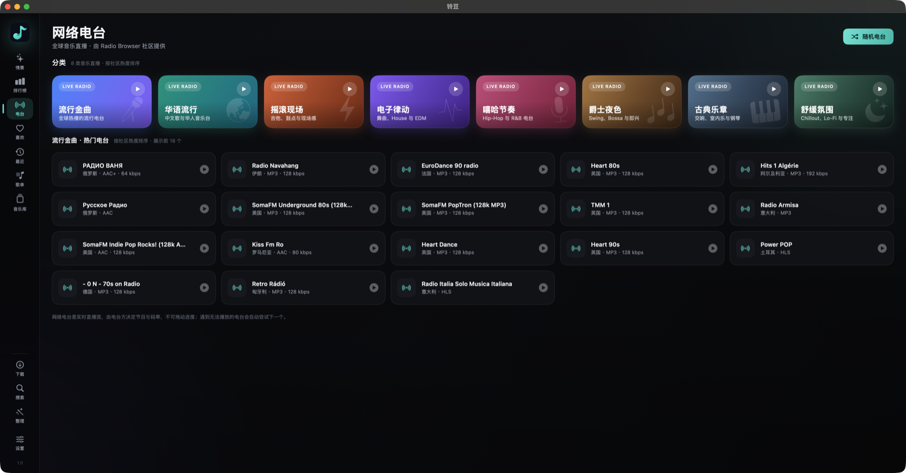

# 音乐下载器（macOS 原生版）

<p align="center">
  
</p>

参考 [musicDownload](../musicDownload)（Python + PySide6）实现的原生 SwiftUI 版本：不依赖 Python 环境，直接编译为独立 macOS 应用，保留原工具的核心功能与交互习惯。界面参考 [vynody](../vynody) 播放器，采用深色沉浸式风格，将「搜索下载」「播放器 / 本地音乐库」「情景电台」与「我的音乐（收藏 / 历史 / 歌单）」整合在同一个应用中。

<p align="center">
  
</p>

## 功能

### 搜索与下载
- 多平台并发搜索：酷我音乐、酷狗音乐、网易云音乐、汽水音乐（可任选一个或多个）
- 搜索结果表格：专辑封面、歌名、歌手、专辑、格式、大小、时长、来源，支持点击表头排序
- 批量下载：勾选任意歌曲下载；下载范围支持「勾选 / 全选 / 未勾选」
- 歌单下载：粘贴酷我、酷狗、网易云歌单链接，自动识别平台并解析；QQ 音乐歌单可导入后在所选音乐源中逐首匹配；汽水音乐支持单曲链接
- 自动下载：开启「搜索后自动下载全部」后，搜索完成即开始下载
- 后台下载：下载任务在独立「下载」页并发执行，不阻塞搜索、播放等其他操作；支持单条 / 批量暂停、继续、重试、移除，并可调整同时下载数量（1–6）
- 低频下载：汽水音乐固定单路、每首间隔约 3 秒（附加随机抖动），其它音源每首间隔约 0.5 秒，降低触发会员账号下载次数限制的风险
- 歌词：下载音频时同步获取 `.lrc` 歌词（可用时）
- 文件名规则：`歌曲名-歌手-专辑-平台ID.扩展名`，自动替换非法字符
- 下载目录可自定义，默认 `~/Music/已下载音乐`
- 右键菜单：下载此歌曲 / 全选所有歌曲 / 取消全选

### 播放与音乐库
- 在线试听：搜索结果行内播放按钮，支持多源曲目直接播放；VIP 曲目仅能试听片段
- 播放队列：以当前搜索结果为队列，支持上一首 / 下一首、随机播放、列表循环 / 单曲循环；队列在页面右侧展开为列表，可直接点选切换或移除歌曲，不遮挡其他功能
- 沉浸式播放页：模糊封面背景、波形进度条、音量控制、展开 / 收起
- 歌词：在线获取 LRC 并逐行高亮滚动；Audius 曲目自动按歌名 / 歌手 / 时长从 LRCLib 与网易云、酷狗、酷我匹配歌词；本地歌曲读取同名 `.lrc` 文件
- 本地音乐库：自动扫描保存目录中的 MP3 / FLAC / M4A / AAC / WAV / OGG / APE，读取内嵌封面与标签；新下载完成即自动加入
- 歌曲 / 专辑视图：可在「歌曲」列表与「专辑」封面网格之间切换；专辑按「专辑名 + 首位歌手」分组，未识别专辑的曲目会在网格下方单独提示数量
- 整理元数据：一键扫描缺失标题 / 歌手 / 专辑 / 年份 / 封面的歌曲，先并行查询网易云与 QQ 音乐，未命中或字段不全时再自动改用酷我、酷狗补全并合并同曲信息，在独立「整理」页逐首确认后再写入；扫描与写入均在后台进行，可随时切换到其它页面，按钮与侧栏会实时显示进度；写入完成后自动刷新音乐库与专辑分组
- 音乐库筛选：支持按歌手多选筛选，歌手列表按歌曲数量从多到少降序排列并可搜索，叠加关键词搜索；筛选结果可直接「播放全部」
- 迷你播放器：底部常驻，显示封面、歌曲信息、波形进度与上一首 / 播放 / 下一首；在线歌曲可直接收藏 / 下载 / 添加到歌单，右侧提供播放队列与展开播放页入口

### 我的音乐
- 收藏：在搜索结果、播放页或历史列表中点心形按钮即可收藏 / 取消收藏，收藏列表支持一键播放
- 历史记录：自动记录试听过的歌曲与播放时间，按最近播放排序，自动去重并保留最近 300 首，可一键清空
- 自定义歌单：新建歌单，从搜索结果、播放页或历史中把歌曲加入歌单；歌单页采用左侧歌单导航 + 右侧详情的二级页面布局，支持播放全部、移除歌曲，以及重命名、复制、删除歌单；并可一键下载整个歌单或勾选多首后批量下载
- 导入歌单：粘贴酷我 / 酷狗 / 网易云歌单链接直接导入；QQ 歌单会使用当前启用的音乐源逐首匹配后导入
- 本地持久化：收藏、历史与歌单保存在 `~/Library/Application Support/MusicDownloader/userdata.json`，重启应用后保留

### 情景电台
<p align="center">
  
</p>

- 8 个情景场景：深夜独处、通勤路上、专注心流、运动燃脂、雨天窗前、咖啡午后、睡前放松、怀旧金曲
- 情景推荐：按场景关键词在酷我 / 酷狗 / 网易云中随机检索，跨源去重后组成播放队列，点击即播
- 榜单电台：酷我热歌榜 / 新歌榜 / 飙升榜、网易云热歌榜 / 飙升榜、酷狗 TOP500，每次随机抽取 20 首
- 无限续播：队列即将播完时自动拉取下一批并接续播放；曲目无法播放时自动跳过
- 随机开播：一键从全部情景与榜单中随机启动一个电台

## 支持平台

| 平台 | 搜索 | 歌单 | 歌词 | 榜单 | 下载 |
| --- | --- | --- | --- | --- | --- |
| 酷我音乐 | ✅ | ✅ | ✅ | ✅ 热歌 / 新歌 / 飙升 | ✅ 优先无损 FLAC，失败时回退 MP3 |
| 酷狗音乐 | ✅ | ✅ | ✅ | ✅ TOP500 | ✅ MP3 / FLAC |
| 网易云音乐 | ✅ | ✅ | ✅ | ✅ 热歌 / 飙升 | ✅ MP3 |
| Audius | ✅ | — | ✅ 自动匹配 | ✅ 趋势榜 | ✅ MP3 |
| 汽水音乐 | ✅ | 单曲链接 | ✅ | — | ✅ M4A（填写会员 Cookie 后可下载会员曲目） |

> QQ 音乐链接暂不支持直接搜索或下载，但可以把 QQ 歌单链接粘贴到「解析歌单链接」模式，应用会读取歌单全部曲目，并在勾选的音乐源中按歌名、歌手、时长逐首匹配出可下载的版本。

## 系统要求

- macOS 14.0 或更高版本（Apple Silicon / Intel 均可）
- 构建需要 Xcode 命令行工具（Swift 6，Package tools 6.0）

## 构建与运行

```bash
cd MusicDownloaderMac

# 1. 直接运行（开发调试）
swift run -c release MusicDownloader

# 2. 打包成独立 App
bash scripts/build_app.sh

# 3. 启动
open dist/MusicDownloader.app
```

`build_app.sh` 会编译 release 版本、组装 `dist/MusicDownloader.app`，并进行本地临时签名（ad-hoc）。应用未做公证，首次启动如被系统拦截，可在 Finder 中右键选择「打开」。

## 使用说明

1. 在「音乐源」中勾选需要的平台（默认酷我 + 酷狗，可勾选汽水音乐）。
2. 设置「单源获取数量」「保存目录」，按需开启「搜索后自动下载」。
3. 搜索模式选择「搜索歌曲」输入关键词，或选择「解析歌单链接」粘贴歌单地址，回车或点击「立即搜索」。QQ 音乐歌单链接同样粘贴到该模式，应用会先读取全部曲目，再在已勾选的音乐源中逐首搜索匹配，结果显示在表格中即可批量下载。
4. 在结果列表中勾选歌曲，选择下载范围后点击「下载」；点击行内播放按钮即可试听。
5. 底部的迷你播放器可展开为全屏播放页，查看大封面与歌词；迷你播放器或播放页的队列按钮会在右侧展开播放列表，可直接点选切换或移除歌曲。
6. 「音乐库」页展示保存目录内的全部歌曲，支持本地搜索、按歌手筛选、播放全部与在 Finder 中显示；歌手筛选按歌曲数量从多到少排列，可多选与搜索。右上角可在「歌曲 / 专辑」视图间切换，点击专辑卡片会切回「歌曲」视图并按该专辑的歌手筛选；标题右侧的「整理元数据 · N」会进入独立的「整理」页，扫描 N 首缺标签的歌曲并逐首给出补全建议。扫描与写入在后台运行，期间可切到其它页面继续搜索或播放，音乐库按钮与侧栏「整理」会显示分析 / 写入进度或待确认数量；确认后写回音频文件并刷新音乐库（写入前请先核对建议，必要时在 `/tmp` 副本上试用）。
7. 「我的」页集中管理收藏、播放历史与歌单：可播放收藏 / 历史，新建歌单、粘贴链接导入歌单，或在任意歌曲的右键菜单 / 播放页中「添加到歌单」。歌单页左侧为歌单导航列表，右侧展示所选歌单的歌曲详情；「下载全部」可一键加入整个歌单，「选择」可勾选多首后下载所选歌曲；右键歌单或点击详情页铅笔按钮可重命名，右键还可复制或删除歌单。
8. 「电台」页选择一个情景或榜单即可开始持续播放；队列快播完时会自动补充新歌，遇到无法播放的曲目会自动跳过。右上角「随机开播」可随机选一个电台。

已下载优先本地播放：无论歌曲最初匹配的是哪个平台，只要本地曲库中存在同歌名 + 歌手的文件（包括换源下载的版本），歌单 / 收藏 / 历史中点播或「播放全部」都会直接播放本地文件，歌单行会显示「本地」标记；未下载的歌曲仍在线解析播放。

汽水音乐会员曲目：在「设置 → 汽水音乐」中填入汽水音乐账号的 Cookie 并验证后，带「M4A·VIP」标记的会员曲目会使用该账号的播放权益解析完整音频。Cookie 可在汽水音乐 PC 客户端登录后，用 Fiddler / Charles 等抓包工具复制发往 `api.qishui.com` 的 Cookie 请求头获得；Cookie 只保存在本机，仅用于向汽水官方接口校验账号与获取播放地址，账号需为有效会员。

下载前会弹出确认框展示歌曲与保存目录；确认后任务进入「下载」页后台队列，按设定并发数下载，期间可继续搜索、播放或浏览歌单。任务支持暂停 / 继续 / 重试，完成后可一键在 Finder 中显示，并自动加入音乐库与歌词。

跨平台自动换源：若某首歌曲在原平台因版权 / 会员 / 下架等原因无法下载，应用会按歌名、歌手与时长在酷我、酷狗、网易云中自动匹配同名歌曲（优先酷我），最多尝试 4 个候选，成功后任务会标注「已自动改用×××版本」。汽水音乐接口目前基本无法完成下载，暂不参与自动换源与「换源」菜单。

播放页快捷键：可在菜单栏「播放」中使用播放 / 暂停、上一首、下一首。

## 命令行调试工具

项目附带 `mdl-smoke`，用于验证各平台接口是否可用：

```bash
swift build -c debug --product mdl-smoke

./.build/debug/mdl-smoke search kuwo 晴天 5
./.build/debug/mdl-smoke download kugou 晴天 /tmp/music
./.build/debug/mdl-smoke search qishui 晴天 5
./.build/debug/mdl-smoke playlist "https://music.163.com/#/playlist?id=3778678"
./.build/debug/mdl-smoke qqplaylist "https://y.qq.com/n/ryqq/playlist/9262930475" 10
./.build/debug/mdl-smoke qqmatch "https://y.qq.com/n/ryqq/playlist/9262930475" 8
./.build/debug/mdl-smoke radio chart kuwo-hot
./.build/debug/mdl-smoke radio scene 深夜 治愈
./.build/debug/mdl-smoke fallback kugou 晴天
./.build/debug/mdl-smoke lyrics netease 晴天
./.build/debug/mdl-smoke lyrics match "Blinding Lights" "The Weeknd" 200
./.build/debug/mdl-smoke enrich /tmp/music-test            # 只预览建议，不写入
./.build/debug/mdl-smoke enrich /tmp/music-test --apply    # 写入标签与封面
./.build/debug/mdl-smoke enrich /tmp/music-test --limit 5 --no-cover
```

`search` 支持 `kuwo`、`kugou`、`netease`、`qishui`、`audius` 五个平台；`lyrics` 用 `match <标题> <歌手> [时长秒]` 可直接验证 Audius 的歌词匹配链路；`radio chart` 的榜单 ID 可用 `kuwo-hot`、`kuwo-new`、`kuwo-rising`、`netease-hot`、`netease-rising`、`kugou-top500`、`audius-trending`。

## 项目结构

```
MusicDownloaderMac/
├── Package.swift
├── Sources/
│   ├── MusicCore/              # 与界面无关的核心层
│   │   ├── Models.swift        # Song / MusicSource / 下载范围等模型
│   │   ├── HTTPClient.swift    # URLSession 封装、超时与重试策略
│   │   ├── KuwoClient.swift    # 酷我搜索、歌单、歌词、下载地址解析
│   │   ├── KugouClient.swift   # 酷狗搜索、歌单、歌词、下载地址解析
│   │   ├── NeteaseClient.swift # 网易云搜索、歌单、歌词、外链解析
│   │   ├── QishuiClient.swift  # 汽水音乐搜索、单曲解析、歌词、音频地址
│   │   ├── SearchService.swift # 并发多源搜索、歌单解析
│   │   ├── QQPlaylistService.swift # QQ 歌单解析、多源逐首匹配
│   │   ├── RadioService.swift  # 榜单拉取、情景关键词检索与随机抽取
│   │   ├── LyricsMatcher.swift # Audius 歌词匹配（LRCLib + 原平台兜底）
│   │   ├── DownloadService.swift # 下载、试听检测、歌词写入、命名
│   │   ├── AudioTagReader.swift # 标签与内嵌封面读取（含 FLAC 图片解析）
│   │   ├── MetadataEnricher.swift # 网易云 / QQ 音乐匹配缺失元数据，酷我 / 酷狗兜底补全
│   │   ├── MetadataWriter.swift # 调用 ffmpeg 写回标签与封面
│   │   ├── LooseJSON.swift     # 兼容单引号伪 JSON 的宽松解析器
│   │   └── TextUtils.swift     # HTML 实体、GB18030、文件名清洗等
│   ├── MusicDownloaderApp/     # SwiftUI 界面层
│   │   ├── App.swift
│   │   ├── AppViewModel.swift
│   │   ├── ContentView.swift
│   │   ├── Theme.swift         # 深色主题与通用组件
│   │   ├── PlaybackModels.swift # 播放条目、歌词解析、音乐库曲目模型
│   │   ├── PlayerService.swift  # AVPlayer 播放引擎、队列与控制
│   │   ├── MusicStore.swift     # 收藏、历史、自定义歌单与本地持久化
│   │   ├── LibraryStore.swift   # 本地音乐库扫描与元数据读取
│   │   ├── SearchPage.swift     # 搜索与下载页
│   │   ├── DownloadManager.swift # 后台下载队列、并发与暂停 / 继续
│   │   ├── DownloadPage.swift   # 下载任务页
│   │   ├── LibraryPage.swift    # 本地音乐库页（歌曲 / 专辑视图与歌手筛选）
│   │   ├── MetadataRepairPage.swift # 整理元数据独立页（后台扫描 / 写入与进度）
│   │   ├── MinePage.swift       # 我的音乐页（收藏 / 历史 / 歌单）
│   │   ├── RadioModels.swift    # 情景电台场景定义与配色
│   │   ├── RadioStore.swift     # 电台状态、榜单 / 情景加载与刷新
│   │   ├── RadioPage.swift      # 情景电台页
│   │   ├── MiniPlayerView.swift # 底部迷你播放器
│   │   ├── PlaybackQueuePanel.swift # 右侧播放队列侧栏
│   │   ├── NowPlayingView.swift # 沉浸式播放页与歌词面板
│   │   └── SettingsView.swift   # 设置面板
│   └── MDLSmoke/               # 命令行冒烟测试工具
├── scripts/
│   ├── Info.plist
│   ├── build_app.sh
│   ├── AppIcon.icns
│   ├── icon_master.png
│   └── make_icon.swift        # 图标绘制脚本（输出 2048px 母版）
└── docs/
```

## 实现说明

- 各平台的搜索、歌单、歌词接口均按其 Web/移动端接口实现；酷我返回的是单引号伪 JSON，核心层内置了宽松解析器。
- 汽水音乐通过公开目录接口搜索，匿名访问时会员曲目只能获取约 30 秒试听，免费曲目可下载完整 M4A；歌词为 KRC 格式，已转换为标准 LRC。搜索结果常为翻唱/纯音乐版本，与原平台版权曲库有关。
- 汽水音乐会员权益通过账号 Cookie 接入：解析时优先使用账号播放接口返回的完整音频，未取到完整时长时回退到分享页兜底，并与歌曲标注时长比对以识别试听片段；账号信息通过 `luna/pc/me` 校验。Cookie 仅保存在本机，不会上传到其他服务。
- 酷我无损下载优先通过第三方解析接口获取 FLAC，再回退到官方 MP3 试听地址；下载完成后会用 AVFoundation 校验实际时长，若明显短于歌曲标注时长（试听片段），会判定失败并提示可能需要会员。
- 文件名中的非法字符（`\ / * ? : " < > |`）统一替换为 `_`；酷我歌词为 XOR + zlib + GB18030 编码，已按原算法解密。
- 网络层使用共享 Cookie 与缓存，酷狗、网易云接口所需的 Referer / Cookie 头均已处理。
- 播放基于 AVFoundation：在线曲目播放前先调用各平台解析接口获取音频地址，本地曲目直接播放文件；歌词按时间轴二分查找当前行，并随进度自动滚动。
- Audius 官方接口不提供歌词：播放时按歌名 / 歌手 / 时长先查 LRCLib（精确匹配失败后转为搜索并按标题、歌手、时长打分），仍未命中时依次在网易云、酷狗、酷我中匹配同曲再取歌词；平台返回的 LRC 若带有 `[ti:]` / `[ar:]` 头且与目标明显不一致会被丢弃，冷门曲目宁可不显示歌词也不显示错误歌词。匹配结果（包括未命中）会在本次运行内缓存，避免电台循环时重复请求。
- 本地音乐库直接读写保存目录，封面优先取缓存中的在线封面，其次读取音频文件内嵌封面；无内嵌封面的旧文件显示占位图。
- 音乐库的发行年份与曲风来自音频文件标签（ID3 `TYER` / `TDRC` / `TCON`、Vorbis `DATE` / `GENRE` 等）。音源下载的文件通常只写入歌名、歌手与专辑，因此多数歌曲的年份 / 曲风为空；音乐库筛选目前只提供歌手维度，按每个歌手名下的歌曲数量降序排列。
- 整理元数据时，每首缺失标签的歌曲会并行查询网易云与 QQ 音乐，按标题、歌手、时长打分选优；标题完全无重叠的候选会被直接排除，避免「同名歌手 + 时长接近」造成的误匹配。若两边都没有可信结果，或已匹配但仍有缺失字段，会再查询酷我、酷狗，并按标题与歌手一致性合并封面、专辑等字段（不同平台的信息会标注为「A + B」）。建议置信度低于 0.6 的条目默认不勾选，需要在预览中手动确认。
- 写入通过 ffmpeg 完成（`-map_metadata 0 -c:a copy`，封面在 MP3 中转为 MJPEG、其它格式使用 attached_pic），写入前先生成临时文件并用 AVFoundation 校验时长，通过后才替换原文件，同时保留原修改时间；未安装 ffmpeg 时会提示 `brew install ffmpeg`。封面读取使用 ImageIO 按最长边 800px 生成缩略图，避免大封面整幅解码占用内存。
- 情景电台按场景关键词在多个平台检索并随机组合，按「歌名 + 首位歌手」跨源去重，并过滤伴奏 / KTV 版本；榜单电台每次随机抽取 20 首，播到队列末尾时自动拉取下一批，按「来源 + 曲目 ID」去重后接续播放；电台模式下解析失败的曲目会自动跳过（连续多次失败才提示）。
- QQ 歌单通过公开歌单接口分页读取全部曲目（需要 `Referer: https://y.qq.com/`），随后并发在所选音乐源中检索，按歌名匹配度、歌手重合度与时长接近度打分选优，过滤伴奏 / KTV 版本；未匹配到的曲目会跳过并在结果提示中告知数量。
- 收藏、历史与歌单以 JSON 持久化在应用支持目录；歌曲按「来源 + 曲目 ID」去重，历史在每次成功开始播放时刷新时间并置顶，超过 300 首自动截断；歌单内歌曲同样去重，重新打开应用后可直接播放（播放时再解析最新音频地址）。导入歌单名称中的 HTML 实体（如 emoji 数字实体）会在导入与应用启动时自动解码。

## 已知限制

- 版权限制：部分歌曲（尤其是网易云、酷狗）可能因版权或接口调整无法下载，或只能获取试听片段。
- 酷我无损依赖第三方解析服务，服务不可用时会自动回退 MP3。
- 表格中的「格式 / 大小」来自搜索接口返回的元数据；酷我实际下载可能为无损 FLAC，因此与列表显示可能存在差异。
- 汽水音乐匿名接口不支持歌单解析；未填写会员 Cookie 时，会员曲目只能获取试听片段。填写 Cookie 后仍需账号具备有效会员，且部分仅提供加密容器（spade）的曲目可能无法解析为可下载文件。Cookie 过期后需在设置中重新填入。
- 在线播放依赖网络与平台解析接口，接口波动或曲目下架时可能无法播放；VIP 曲目在线试听同样受片段限制。
- 电台的榜单与情景检索依赖各平台公开接口，接口调整时个别榜单可能暂时无法获取；此时情景电台会跳过失败曲目并继续播放。
- QQ 歌单导入依赖其他平台的搜索结果，冷门曲目、现场版或翻唱版本可能匹配失败或匹配到近似版本；导入后可在「来源」「时长」列核对再批量下载。
- 整理元数据依赖网易云 / QQ 音乐的公开搜索接口与本地 ffmpeg，只写标题、歌手、专辑、年份与封面（不改歌名、不重命名文件）；冷门曲目或翻唱版本可能匹配失败，建议勾选前逐条核对，重要文件先在副本上试写。
- 收藏与历史面向在线试听曲目；本地音乐库曲目仍通过「音乐库」页浏览与播放，不会写入播放历史。
- 暂未支持 QQ 音乐、咪咕音乐（原 Python 工具的这两个源接口已失效或依赖加密签名）。
- 仅供个人学习与备份合法拥有的音乐使用，请遵守各平台服务条款。

## 致谢

- 原始项目：[MrsEWE44/musicDownload](https://github.com/MrsEWE44/musicDownload)
- 底层库：[CharlesPikachu/musicdl](https://github.com/CharlesPikachu/musicdl)
